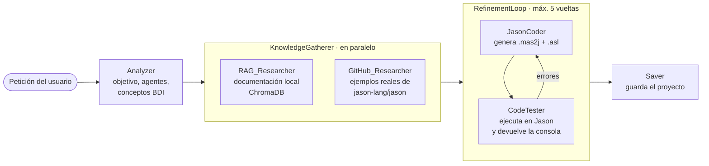

# MetaMAS BDI Developer

Sistema multiagente que **escribe sistemas multiagente**. A partir de una descripción en lenguaje natural ("una subasta holandesa con un subastador y cuatro participantes"), un equipo de agentes LLM orquestados con **Google ADK** analiza el problema, busca documentación y ejemplos, genera el código en **Jason/AgentSpeak**, lo ejecuta para comprobar que funciona y lo corrige hasta que lo hace.

Proyecto de la asignatura *Agentes Inteligentes* (Universitat Politècnica de València, 2026).

> **English summary:** an LLM-based multi-agent pipeline (Google ADK + LiteLLM) that turns a natural-language request into a working BDI multi-agent system in Jason/AgentSpeak. It retrieves documentation (RAG with ChromaDB) and real examples from GitHub in parallel, then iterates a coder/tester loop that runs the generated code in Jason and feeds the console output back until it works.

## Cómo funciona



1. **Analyzer** convierte la petición en un resumen estructurado: objetivo, agentes y sus roles, conceptos técnicos de Jason y nombre del proyecto.
2. **KnowledgeGatherer** lanza dos investigadores en paralelo. Uno consulta la documentación de Jason indexada en ChromaDB (RAG) y el otro navega los ejemplos oficiales del repositorio de Jason en GitHub.
3. **RefinementLoop** alterna un programador y un tester. El tester ejecuta el código en Jason con un límite de tiempo y devuelve la salida de consola tal cual. El programador la lee y corrige. Si se agotan los intentos, se queda con la versión que menos errores dio.
4. **Saver** escribe el proyecto final (`.mas2j` y un `.asl` por agente) en `output/`.

## Problemas que hubo que resolver

Trabajar con agentes LLM encadenados da problemas que no aparecen con una sola llamada al modelo:

- **Llamadas a herramientas inventadas o mal formadas.** El modelo a veces añadía tokens internos al nombre de la herramienta y rompía la llamada. Se resolvió con instrucciones estrictas y con nombres de herramientas explícitos en el prompt.
- **Bucles sin fin de herramientas.** Cada investigador tiene un protocolo de tres llamadas como máximo, el bucle de refinamiento tiene un tope de iteraciones y el tester tiene un límite de ejecuciones.
- **Tiempos de espera en el RAG y en Jason.** El índice se construye una sola vez y se reutiliza, y la ejecución de Jason tiene un timeout de 15 s, que se interpreta como "el sistema sigue vivo" y no como un fallo.
- **Conflictos con asyncio.** Terminar el proceso con `sys.exit()` dentro del runner asíncrono rompía la ejecución, así que se sustituyó por una excepción propia (`MASCompletedException`).
- **Sintaxis de AgentSpeak fiable.** El prompt del programador recoge las reglas que el modelo fallaba más: puntuación de los planes, arranque con `!start`, `.stopMAS` para terminar y formato del `.mas2j`.
- **Modelos con y sin razonamiento.** El programador usa el modelo con razonamiento y el tester y el guardado usan el mismo modelo con el razonamiento desactivado, porque solo tienen que ejecutar y copiar.

## Tecnologías

Python · Google ADK (`SequentialAgent`, `ParallelAgent`, `LoopAgent`) · LiteLLM con un endpoint compatible con OpenAI · ChromaDB · Jason / AgentSpeak

## Puesta en marcha

1. Instala las dependencias y Jason siguiendo [`bdi_agent_example/INSTALL.md`](bdi_agent_example/INSTALL.md).
2. Copia [`.env.example`](.env.example) a `bdi_agent_example/.env` y rellena el endpoint y la clave de tu proveedor de modelos (cualquier API compatible con OpenAI).
3. Pon la documentación de Jason que quieras usar para el RAG en `bdi_agent_example/docs/` (ver [`docs/README.md`](bdi_agent_example/docs/README.md)) y genera el índice:

   ```bash
   cd bdi_agent_example
   python update_rag.py
   ```

4. Ejecuta el ejemplo incluido (la subasta holandesa):

   ```bash
   python agent.py
   ```

   El proyecto generado aparece en `output/<nombre>/`.
